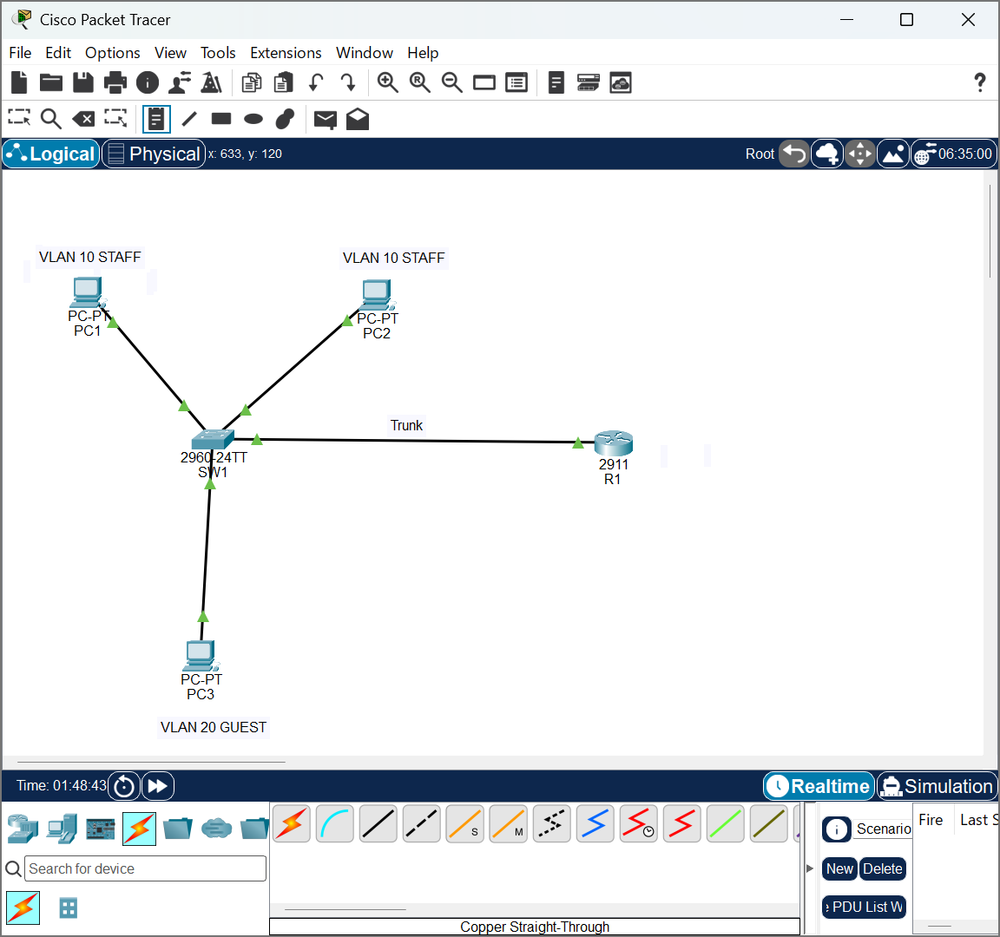
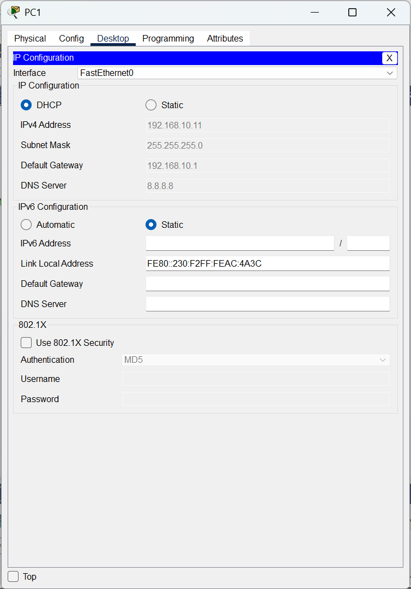
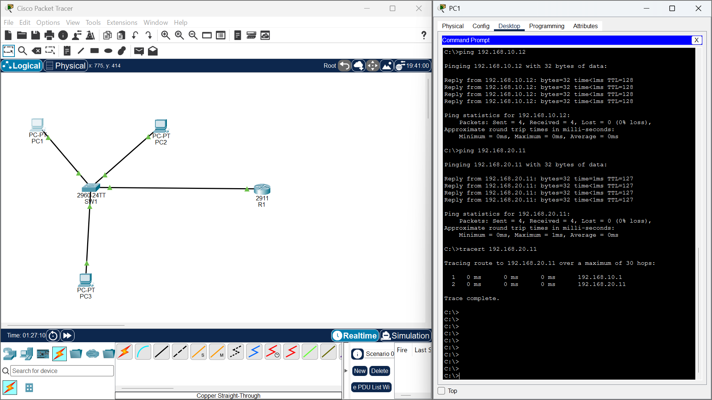
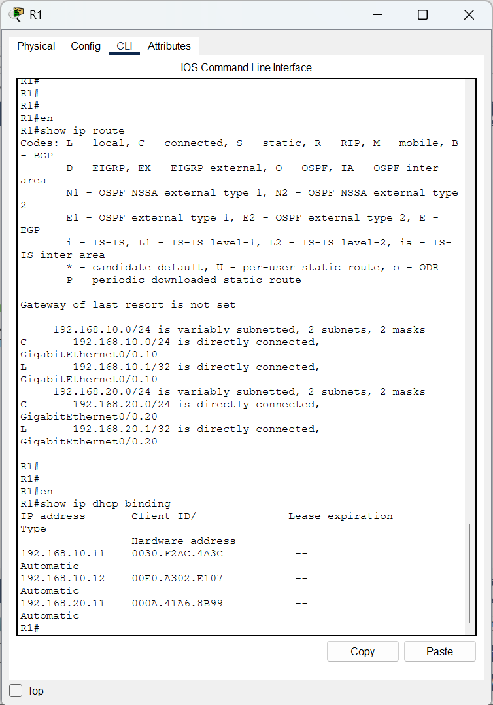
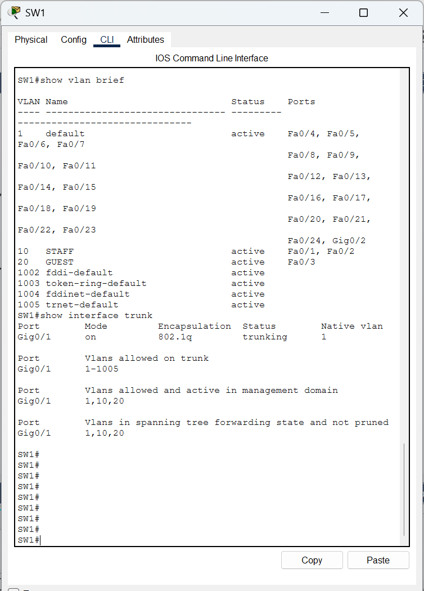

# VLANs and Inter-VLAN Routing in Cisco Packet Tracer

A small lab where a router hands out IP addresses by DHCP, a switch is split into two VLANs, and devices in different VLANs reach each other through the router ("router-on-a-stick").

**Tools:** Cisco Packet Tracer, Cisco IOS command line

## Goal

- Set up a router as a DHCP server
- Split one switch into two VLANs (STAFF and GUEST)
- Connect the VLANs to the router with a trunk link and subinterfaces
- Prove that devices in different VLANs can communicate, using ping and traceroute

## Topology



Three PCs connect to a 2960 switch (SW1). SW1 connects to a 2911 router (R1) with a single cable that carries both VLANs.

## Addressing plan

| VLAN | Name | Subnet | Gateway (R1) | Devices | Switch ports |
|---|---|---|---|---|---|
| 10 | STAFF | 192.168.10.0/24 | 192.168.10.1 | PC1, PC2 | Fa0/1, Fa0/2 |
| 20 | GUEST | 192.168.20.0/24 | 192.168.20.1 | PC3 | Fa0/3 |

Addresses .1 to .10 are excluded from DHCP, so the PCs receive addresses starting at .11. The trunk runs between SW1 Gi0/1 and R1 Gi0/0.

## How I built it

1. Built the topology and first put all PCs in one network (192.168.1.0/24) with DHCP on the router, to confirm that DHCP worked.
2. Created VLANs 10 and 20 on the switch, set the PC ports as access ports and the uplink to the router as a trunk.
3. Removed the single network from the router and created one subinterface per VLAN (802.1Q), each with its own DHCP pool.
4. Renewed DHCP on each PC and tested connectivity.

### Switch configuration (SW1)

```
vlan 10
 name STAFF
vlan 20
 name GUEST
interface range fastEthernet 0/1 - 2
 switchport mode access
 switchport access vlan 10
interface fastEthernet 0/3
 switchport mode access
 switchport access vlan 20
interface gigabitEthernet 0/1
 switchport mode trunk
```

### Router configuration (R1)

```
interface gigabitEthernet 0/0
 no shutdown
interface gigabitEthernet 0/0.10
 encapsulation dot1Q 10
 ip address 192.168.10.1 255.255.255.0
interface gigabitEthernet 0/0.20
 encapsulation dot1Q 20
 ip address 192.168.20.1 255.255.255.0
ip dhcp excluded-address 192.168.10.1 192.168.10.10
ip dhcp excluded-address 192.168.20.1 192.168.20.10
ip dhcp pool STAFF
 network 192.168.10.0 255.255.255.0
 default-router 192.168.10.1
 dns-server 8.8.8.8
ip dhcp pool GUEST
 network 192.168.20.0 255.255.255.0
 default-router 192.168.20.1
 dns-server 8.8.8.8
```

## Verification

### PC1 received its address by DHCP



PC1 is set to DHCP and received 192.168.10.11, with 192.168.10.1 as its gateway, from the router.

### Connectivity within and across VLANs



PC1 can ping PC2 (same VLAN) and PC3 (different VLAN). The `tracert` to PC3 shows 192.168.10.1 (R1) as the first hop, which confirms the traffic between the VLANs is routed by the router. In my first test run, the first ping across VLANs timed out once while the router resolved PC3's address (ARP). After that, replies came back normally.

### Router: DHCP leases and routes



`show ip dhcp binding` lists a lease for each PC, and `show ip route` shows both VLAN networks as directly connected through the subinterfaces Gi0/0.10 and Gi0/0.20.

### Switch: VLANs and trunk



`show vlan brief` shows PC1 and PC2 ports in STAFF (VLAN 10) and the PC3 port in GUEST (VLAN 20). `show interfaces trunk` shows Gi0/1 trunking with VLANs 1, 10 and 20.

## What I learned

- A VLAN splits one physical switch into separate networks, so devices in different VLANs cannot talk to each other without a router.
- A trunk port carries several VLANs over one cable, and access ports carry a single VLAN to an end device.
- With router-on-a-stick, each VLAN gets a router subinterface that acts as its default gateway.
- A DHCP pool and excluded address range on the router give each VLAN automatic addressing.
- Ping, traceroute and the `show` commands (`show vlan brief`, `show interfaces trunk`, `show ip route`, `show ip dhcp binding`) are the quickest ways to check where a problem is.

## Files

- `VLAN-InterVLAN-Lab.pkt`: the Packet Tracer file (open it with Cisco Packet Tracer)
- `screenshots/`: evidence of the working lab
